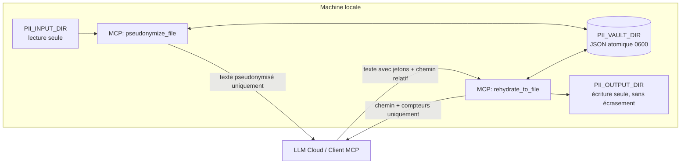

# pii-vault-mcp — Pseudonymisation réversible RGPD (Art. 4(5)) 100 % locale pour le français & serveur MCP

[](https://github.com/NikoGandon/pii-vault-mcp/actions/workflows/ci.yml)
[](https://www.python.org/downloads/)
[](https://mypy-lang.org/)
[](LICENSE)

Librairie Python et **serveur MCP (Model Context Protocol) à frontière fichier** pour pseudonymiser localement des documents français avant tout appel à un LLM cloud, puis réhydrater les rapports localement dans un fichier protégé à partir d'un coffre persistant (`PiiVault`).

> **Précision juridique RGPD** : un coffre réversible réalise une **pseudonymisation** au sens de l'**Article 4(5) du RGPD**, et non une anonymisation irréversible. Les données restent des données à caractère personnel tant que le coffre existe ; celui-ci reste strictement local (écriture atomique, permissions `0600`) et ne quitte jamais la machine.

---

## Modèle de menace MCP : séparation stricte entrée / sortie

Avec MCP, **c'est le LLM distant qui rédige les arguments et lit les sorties de chaque outil**. Deux classes d'attaques doivent être bloquées dans le code :
1. **Exposition directe** : un outil `pseudonymize_text(text=...)` ou `rehydrate_text(...)` exposerait les données brutes dans le contexte du modèle cloud.
2. **Exfiltration par enchaînement d'outils** : si `rehydrate_to_file` écrivait dans le même dossier que celui lu par `pseudonymize_file`, un agent victime d'injection de prompt pourrait réhydrater `X[IBAN_01]X` dans un fichier puis le relire via `pseudonymize_file` (ou écraser un document source).

`pii-vault-mcp` impose donc **trois dossiers strictement disjoints** (*fail-closed* si absents, confondus ou imbriqués) :



- **`pseudonymize_file(input_path, vault_id)`** : lit uniquement dans `PII_INPUT_DIR` (chemins relatifs, liens symboliques sortants refusés), exécute `assert_no_leak` (y compris sous-chaîne compacte contre les contournements type `XFR76...X`), et renvoie uniquement le texte pseudonymisé + stats.
- **`rehydrate_to_file(text, output_path, vault_id)`** : crée un **nouveau fichier** (`O_EXCL`, mode `0600`, écrasement refusé) dans `PII_OUTPUT_DIR` et ne renvoie au modèle que le chemin relatif et le nombre de jetons restaurés.
- **`inspect_vault(vault_id)`** : renvoie uniquement compteurs et nombre de patronymes ambigus (jamais de valeur brute).
- **`verify_no_leak(text, vault_id)`** : contrôle *fail-closed* (lève `FileNotFoundError` si le coffre n'existe pas ; détecte les identifiants structurés même collés à d'autres lettres).
- Les messages d'erreur ne divulguent jamais les chemins absolus de la machine hôte.

Complémentaire à [metis-d0](https://github.com/NikoGandon/metis-d0) : **Mêtis D0** contrôle la fiabilité de ce qui *sort* du LLM ; **`pii-vault-mcp`** contrôle la confidentialité de ce qui *entre* dans le LLM.

---

## Pourquoi pas Microsoft Presidio ?

Microsoft Presidio gère très bien les entités génériques et valide déjà les IBAN (mod-97). `pii-vault-mcp` cible un périmètre plus étroit mais spécifique aux dossiers français (finance, M&A, RH, juridique) :

| Critère | Microsoft Presidio | `pii-vault-mcp` |
| :--- | :--- | :--- |
| **Identifiants français** | IBAN (mod-97) présent ; NIR Corse et SIREN/SIRET à écrire soi-même | **IBAN (mod-97)**, **NIR FR (Corse 2A/2B + clé 97)**, **SIREN / SIRET (Luhn + La Poste)** avec protection contre les montants (`125 000 000 EUR`), **téléphones FR** (`0612345678`, `06 12 ...`, `+33`) |
| **Chaînage patronymique** | Non natif | `M. Pierre Dupont` et `LOYER SCI DUPONT` partagent `[PERSONNE_01]` (indépendant de l'ordre) |
| **Homonymes & civilités** | — | `M. Pierre Dupont` + `Mme Marie Dupont` (ou `M. Dupont` + `Mme Marie Dupont`) marquent `dupont` comme `__AMBIGUOUS__` : jamais de fusion à tort |
| **Frontière MCP fichier** | À construire | **Serveur MCP v2 natif** à dossiers `PII_INPUT_DIR` (RO) / `PII_OUTPUT_DIR` (WO, sans écrasement) strictement disjoints + coffre `0600` |
| **Empreinte & tests** | spaCy + modèles NLP | Cœur **Pydantic seul** (< 0,5 s en CI, `mypy --strict`, `hypothesis`), NER local **GLiNER** branchable en extra `[ner]` |

> **Comportement de réhydratation** : lorsqu'une mention courte comme `SCI DUPONT` est chaînée au porteur unique `Pierre Dupont` (`[PERSONNE_01]`), la réhydratation écrit la forme canonique du coffre (`SCI Pierre Dupont`) plutôt que la casse d'origine. C'est volontaire afin d'identifier sans ambiguïté la personne physique dans le rapport restauré.

---

## Corpus synthétique de non-régression (71 documents, 25 pièges, 0 USD)

Le script [evals/run_benchmark.py](evals/run_benchmark.py) exécute le moteur déterministe seul (sans GLiNER) sur **71 documents synthétiques français** générés de manière reproductible par [evals/generate_corpus.py](evals/generate_corpus.py) ([evals/corpus_fr.jsonl](evals/corpus_fr.jsonl)). Il est exécuté en CI avec `--check` pour bloquer toute régression.

> **Limite méthodologique** : ce corpus synthétique a été construit avec les mêmes hypothèses que les détecteurs pour tester la non-régression, les clés de contrôle et les pièges adversariaux. Il ne constitue pas une évaluation sur des documents réels non vus en production.

| Type d'entité | Précision | Rappel | F1 | Détail (TP / FP / FN) |
| :--- | :---: | :---: | :---: | :---: |
| `EMAIL` | **100,0 %** | **100,0 %** | **100,0 %** | 22 / 0 / 0 |
| `IBAN` *(mod-97)* | **100,0 %** | **100,0 %** | **100,0 %** | 12 / 0 / 0 |
| `NIR` *(clé 97, Corse 2A/2B)* | **100,0 %** | **100,0 %** | **100,0 %** | 11 / 0 / 0 |
| `SIREN` *(contexte + Luhn)* | **100,0 %** | **100,0 %** | **100,0 %** | 10 / 0 / 0 |
| `SIRET` *(Luhn + La Poste)* | **100,0 %** | **100,0 %** | **100,0 %** | 10 / 0 / 0 |
| `TEL` *(compact, espacé, +33)* | **100,0 %** | **100,0 %** | **100,0 %** | 23 / 0 / 0 |
| `PERSONNE` *(déterministe seul)* | **100,0 %** | **90,9 %** | **95,2 %** | 50 / 0 / 5 |
| **GLOBAL** | **100,0 %** | **96,5 %** | **98,2 %** | **138 / 0 / 5** |

- **Faux positifs sur les 25 pièges négatifs** (montants financiers passant Luhn type `125 000 000 EUR`, faux IBAN/NIR/SIREN/SIRET, enseignes commerciales `Rolex`, `SNCF`, `EDF`, `Chez Michel`, `Bistrot Paul`) : **0 / 25**.
- **Fuites sur entités déjà enregistrées dans le coffre** *(invariant interne `find_leaks`)* : **0 / 71** (y compris retours à la ligne après civilité, villes françaises et patronymes homonymes de mots courants : `Marchand`/`marchandises`, `Petit`/`petit matériel`, `Martin`/`Martinique`).
- **Entités de vérité terrain restées en clair** *(vrais faux négatifs en mode déterministe seul)* : **5 entités dans 5 documents** — ce sont exactement les 5 noms propres nus sans civilité ni mention préalable, couverts lorsque le backend NER local optionnel (`GlinerNerBackend`, extra `[ner]`) est activé.
- **Compromis casse sur patronymes isolés** : un patronyme isolé écrit tout en minuscules (`dupont` seul) n'est pas rattaché (choix assumé pour éviter de masquer des mots courants comme *petit* ou *blanc* ; les noms complets en minuscules comme `pierre dupont` restent bien masqués).

---

## Démarrage rapide

### 1. Installation, tests (`hypothesis`) et non-régression (0 USD)

```bash
python3 -m venv .venv
.venv/bin/pip install -e ".[dev]"

# Tests unitaires + property-based testing (hypothesis) + tests serveur MCP
.venv/bin/pytest -v

# Vérification de typage strict
.venv/bin/mypy --strict pii_vault

# Contrôle de non-régression sur le corpus synthétique FR (échoue si régression)
.venv/bin/python evals/run_benchmark.py --check
```

### 2. Utilisation en Python

```python
from pii_vault import Scrubber, assert_no_leak, rehydrate

scrubber = Scrubber()
text = (
    "Virement LOYER SCI DUPONT (prix 125 000 000 EUR).\n"
    "Associé : M. Pierre Dupont (0612345678, p.dupont@societe.fr), "
    "IBAN FR76 3000 6000 0112 3456 7890 189."
)

res = scrubber.scrub(text)
assert_no_leak([res.pseudonymized_text], scrubber.vault)
print(res.pseudonymized_text)
# -> Virement LOYER SCI [PERSONNE_01] (prix 125 000 000 EUR).
# -> Associé : M. [PERSONNE_01] ([TEL_01], [EMAIL_01]), IBAN [IBAN_01].

print(rehydrate("Conflit potentiel entre [PERSONNE_01] et la SCI.", scrubber.vault))
# -> Conflit potentiel entre Pierre Dupont et la SCI.
```

### 3. Serveur MCP (Claude Desktop / Cursor / clients MCP)

```bash
pip install -e ".[mcp]"
PII_INPUT_DIR=/chemin/local/entree \
PII_OUTPUT_DIR=/chemin/local/sortie \
PII_VAULT_DIR=~/.pii-vault-mcp/vaults \
pii-vault mcp
```

Exemple de configuration client MCP :

```json
{
  "mcpServers": {
    "pii-vault": {
      "command": "pii-vault",
      "args": ["mcp"],
      "env": {
        "PII_INPUT_DIR": "/chemin/local/entree",
        "PII_OUTPUT_DIR": "/chemin/local/sortie",
        "PII_VAULT_DIR": "/chemin/local/vaults"
      }
    }
  }
}
```

### 4. CLI & Docker

```bash
# CLI locale
echo "Client M. Pierre Dupont, 0612345678" | pii-vault scrub --vault ./dossier.json

# Docker (serveur MCP stdio : entrée montée en lecture seule)
docker build -t pii-vault-mcp .
docker run -i --rm \
  -v "$(pwd)/input:/data/input:ro" \
  -v "$(pwd)/output:/data/output" \
  -v "$(pwd)/vaults:/data/vaults" \
  pii-vault-mcp
```

---

## Contact

Nikola Gandon — [LinkedIn](https://www.linkedin.com/in/nikola-gandon/) · [GitHub](https://github.com/NikoGandon)
